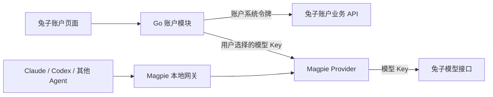

# tuzi-magpie 兔子业务接入方案

日期：2026-11-02（Asia/Shanghai）。任务：TM-ANALYSIS-01。

本文回答“在 Magpie 原有能力上增加与兔子助手一致的兔子业务，需要增加什么、如何实施”。用户已确认本轮桌面范围、四项排除和本地交付边界；最终执行与验收以 [TM-LOCAL-1.0 开发基线](tuzi-magpie-execution-spec.md) 为准。本文提供源码分析和实施依据，不表示功能已开发或上线。用户补充确认：产品名称为 `tuzi-magpie`，保留 Magpie 原有应用图标，不进行图标替换或重新设计；上游项目名称是 `magpie`。本地源码目录暂仍为 `tuzi-mapie`。

## 1. 核查基准

| 仓库 | 本地目录 | 分支 / HEAD | 核查时工作区 |
| --- | --- | --- | --- |
| 兔子助手 | `/Users/syd08/Documents/tuzi-switch` | `codex/enable-hidden-features` / `d4a4a25b554bae2d94cd9219d536d61de22da0ca` | 既有未跟踪产品附件 |
| CC Switch | `/Users/syd08/Documents/ccswitch` | HEAD `aa379e091b597dbcf19ba6834e417155638f05ef` | 干净 |
| Magpie | `/Users/syd08/Documents/tuzi-mapie` | `main` / `2251ca1ce93a837aa31df1158fa9d58437268a71` | 既有未跟踪 `.DS_Store` |
| 兔子 API / 网站 | `/Users/syd08/Documents/tuzi/tuzi-api` | `codex/log-page-refresh` / `34063efc6e053b152b82b45e2076549bfc4fe8b8` | 干净 |

本次未 fetch，不声明本地 HEAD 等于 GitHub 最新版本；未使用真实账户、调用付费模型或核实生产部署。接口依据为 [system-token-v1](api-contract.md)。当前可见性以 [账户开放记录](account-workspace-opening.md) 的 ACCOUNT-OPEN-01～06 为准，覆盖 PRD 内历史 Phase 1 隐藏描述。

本地 CC Switch 已包含普通 Tu-zi 供应商预设。因此，“有兔子地址和图标”本身不足以定义兔子助手增量。真正需要迁入的是完整账户业务、账户 Key 与本地模型配置的衔接，以及兔子专属产品入口。

## 2. 产品形态与原功能保护

保留 Magpie 的 Agents、Providers、路由组、网关、订阅和插件、MCP/Library、会话、用量、备份同步、托盘、CLI/TUI/Web 等既有功能，在主导航增加“兔子账户”。未连接兔子账户时，原有功能仍正常使用。

用户已明确要求增量开发：除名称及新增兔子入口、页面、预设等已确认内容，原页面布局、字体、配色、间距、文案、导航和操作流程尽可能完全一致。新页面采用 Magpie 原设计语言，样式局部隔离；不照搬助手皮肤、不顺带重构或美化上游。开发前保留同条件界面/流程基准，完成后做对照；必要的原行为变化须先说明影响并获得用户确认。详见执行基线第 2.3 节与 AC-16。

兔子账户内部沿用四个横向 Tab：API 密钥、调用明细、模型广场、模型服务状态。默认 API 密钥；余额、今日已记录消费、今日消费调用、今日 Token 四项概要只放密钥页；不增加独立总览页。账户设置入口按兔子助手当前状态隐藏。

进入兔子账户时默认显示密钥页；应用整体启动页按保留上游交互原则沿用 Magpie 习惯，不另加必须改变启动页的需求。

## 3. 完整功能迁入清单

| 模块 | 兔子助手当前能力 | tuzi-magpie 建议 |
| --- | --- | --- |
| 账户连接 | 浏览器获取系统令牌、粘贴连接、条件预填、身份校验、检查连接、重启恢复、断开/切号、离线及失效提示 | 对齐业务行为，用 Go 实现账户客户端和独立文件存储 |
| 四项概要 | 账户余额、今日消费、今日消费调用、今日 Token；人民币/USD 显示 | 复用服务器金额元数据和时间窗口语义 |
| API 密钥 | 搜索、分组、状态筛选、分页、创建、详情、查看/复制、编辑、启停、删除 | 全量迁入；包括额度、到期、模型、IP 等高级限制及写失败回读 |
| 调用明细 | 筛选、分页、单条详情、请求关联摘要、公开错误、列表下方消费统计和趋势/分布 | 使用兔子服务端记录，独立于 Magpie 本地 Usage |
| 模型广场 | 模型搜索、标签/协议/分组/计费类型等筛选、详情、分组目录价格、支持的动态档位、配置入口 | 展示与权限语义对齐；不能把目录价说成个人最终扣费价 |
| 模型服务状态 | 1/6/24 小时、成功率色块、延迟、TTFT、筛选、六模型分页和批量读取 | 复用状态接口；不主动跑模型探测生成状态 |
| 配置到工具 | 从单条 Key 或模型入口选工具/模型、校验权限、生成供应商、定位已有配置 | 改成“加入 Magpie → 为 Agent 选模型”，复用其 Provider/Agent 实现 |
| 主站预设 | 兔子线路、相应协议/端点、图标、模型列表 | 增加 Magpie 原生兔子预设，支持直接手填模型 Key |
| Coding 预设 | Codex 订阅线路、独立 Coding Key、购买/查询入口 | 单独预设和凭证；不从主站账户 Key 自动推导 |
| GACCode 预设 | Claude/Codex 对应端点、独立 Key、购买/额度查询入口 | 单独预设；不与主站余额或 Coding 混合 |
| 充值及网站入口 | 主站充值/兑换、系统令牌区域、Coding 商店、GACCode 商店/查询 | 固定可信链接；网站完成登录和支付 |
| 查询便利 | 供应商卡片充值/查询，部分查询 WebView 临时填入模型 Key | 本轮仅打开固定网页；自动填入查询 Key 明确排除，不能把 Key 放进链接 |
| 名称及发行 | 助手具有名称、图标、关于、帮助/网站、版本历史和独立更新源 | 用户指定只将应用名称改为 `tuzi-magpie`，保留 Magpie 原图标；独立应用身份和更新渠道，保留 MIT 许可与原作者归属 |
| 操作统计 | 固定操作分类和结果，不上报账户业务内容 | 本轮明确不新增用户操作统计上报 |
| 图片 API 接入 | 助手有 Codex 专用图片兼容代码；Magpie 已有生成/编辑图片工具 | 只将兔子图片 API 接入 Magpie 现有工具，不新建生图 Agent 或页面，不整套迁移助手专用代码；配置已兼容时不新增适配代码 |
| 账户资料 | 五字段资料编辑及累计信息实现存在，当前入口不挂载 | 标为后续对齐项；首版不开放隐藏入口 |
| 兔子助手导入 | 可供参考的本地供应商和独立凭证索引 | 本轮明确不新增助手配置导入，不自动扫描迁移账户令牌 |

不新增账户 OAuth/SSO、支付订单、商城统一登录、管理员控制台、完整请求内容、批量 Key 或日志导出。用户已明确 Coding/GACCode 没有登录：两者只提供预设、手动填写各自 Key、选择模型及购买/查询链接，不增加登录流程，不依赖兔子账户连接，不合并主站余额。客户端内嵌 Coding/GAC 额度展示本轮明确不做。

最新展示细节也应对齐：状态页不恢复已移除的吞吐/额外明细入口；模型价格按可见分组目录方案展示，不重复乘倍率、不叠加个人折扣；复杂计费不能可靠展示时引导网站。

## 4. 关键适配：账户接入与模型请求分开

账户系统令牌管理身份、余额、Key、记录等；模型 API Key 才能成为 Provider 的调用凭证；Magpie 给 Agent 的网关访问凭证又是第三种凭证。三者分别保存、分别使用。

账户请求使用固定 `https://api.tu-zi.com` 和受控路径，由 Go 添加 Bearer 与验证所得的 `New-Api-User`。不让页面提交任意 origin、用户 ID 或任意上游 Header；不把系统令牌放进 Provider 的 `Key`、`BalanceToken`、备份、同步或插件配置。

Magpie 已有通用 `BalanceURL/BalanceToken`，只能作为理解其额度展示的参考，不能用它替代兔子账户模块：它与 Provider 配置及同步绑定，不符合助手的账户令牌独立存储语义。

与兔子助手一致采用单一活跃兔子账户；这不限制 Magpie 原有的多 Provider、多模型 Key、多订阅账户。

### 4.1 “配置到工具”的推荐流程

1. 用户在 Key 行点“添加到 Magpie”，或从模型详情选 Key。
2. Go 回读当前账户/Key 状态、分组、模型限制及接口能力；只在需要保存调用凭证时读取完整模型 Key。
3. 展示供应商名称、可用模型、协议和可选目标 Agent。
4. 首版一条账户 Key 对应一个 Provider，名称默认取 Key 名称；同一 Provider 可供多个 Agent 使用。
5. 保存稳定来源关系，例如 `{origin,user_id,token_id,provider_id}`，选择 Agent 时再记录关联。重复添加定位既有 Provider，不靠名称或 Key 后四位判断归属。
6. 通过 Magpie 原有模型选择和 Agent 接入流程启用；完成后定位相应 Provider/Agent。
7. Provider 保存成功而 Agent 接入失败，应明确报告部分成功并提供重试/恢复，不能把跨文件操作声称为天然原子事务。

一条 Key 一个 Provider 是首版默认映射，用于降低权限混淆。Magpie 多 Key 路由可以继续使用；账户 Key 合并进同一 Provider 前，应先处理不同 Key 的分组、模型权限和额度差异，不能只因为域名相同就自动合并。

“保存”“启用”“主动连通性测试”分别处理，保存和打开页面不自动触发付费推理。断开账户中心不轮换网站令牌，也不顺带删除已保存 Provider；远端停用/删除模型 Key 后，该 Key 的请求仍会被服务端拒绝。

### 4.2 协议与模型目录

Magpie 已有 Chat、Responses、Anthropic、Gemini 的接入与转换。兔子适配重点是声明正确的上游地址、鉴权方式和模型能力。

不能整批复制助手表单里的 base URL：各客户端 SDK 对 `/v1` 的拼接语义不同。当前助手就存在 Anthropic 根地址与 `/v1` 地址并存的情况。需要按“Magpie 最终发出的完整 URL”验证 Chat、Responses、Messages、Gemini 的路径及 Header，防止重复 `/v1` 或丢失 `/coding`。

模型广场展示“账户可见目录”；Provider/Agent 可选项还要满足所选 Key 的限制和网关实际支持能力。目录价格/状态不保证某条 Key 一定能调用；模型名称也不能代替协议元数据。未知能力显示待确认或允许明确手动配置，不用猜测做静默路由。

图片范围按后续讨论澄清：保留 Magpie 现有 `generate_image` 工具、图片模型选择和 MCP 接入机制，让其能够使用兔子图片 API。先验证模型识别、地址、鉴权、生成/编辑及返回格式，缺口才补代码；不是迁入整个兔子助手图片方案，也不是新增独立生图 Agent。兔子助手源码包含 `gpt-image-2` 与 `/coding` 路线，可作为兼容核对依据；本会话的生图指令不直接扩大为产品对所有用户强制选用同一模型或线路的规则。本次未生成图片或实际调用图片服务。

## 5. 技术实现建议

兔子助手使用 React/TypeScript + Tauri/Rust；当前 Magpie 使用 Go + Wails v3，GUI 主要为现有 JavaScript/CSS，并有内置插件页面框架。适合复用业务契约、协议规则、文案、视觉资产和测试 fixture；页面及原生调用应按 Magpie 架构实现。

建议落点如下，均为拟新增/拟修改位置，不代表已经创建：

| 拟落点（相对本地 tuzi-mapie 源码目录） | 职责 |
| --- | --- |
| `internal/tuziaccount/` | 连接状态、令牌文件、HTTP 客户端、账户业务 DTO、金额/错误/分页映射、Provider 来源管理 |
| `internal/gui/tuzi_account.go` | 受保护的本地账户 HTTP 路由；复用 GUI 身份和来源防护，限制请求体及字段 |
| `plugins/tuzi/` | 内置兔子页面注册及生命周期；通过既有插件框架接入导航 |
| `internal/gui/assets/plugins/tuzi/` | 四个 Tab、连接页、弹窗、样式和翻译，按页加载/停止刷新 |
| `internal/provider/presets.go` 及必要适配文件 | 主站/Coding/GACCode 预设、模型及协议元数据 |
| `internal/gui/api.go`、`plugins/all/all.go`、GUI 资源入口 | 少量注册与加载改动；不把业务散落进主界面大文件 |
| `internal/appdir/`、应用打包与更新配置 | 独立目录、应用标识、协议、进程/端口和更新来源 |
| 兔子 API 网站引导相关文件 | 识别不同客户端来源并唤起正确应用 |

内置插件负责页面组织，账户秘密和受控业务留在可信 Go 模块；不要求用户额外安装第三方登录插件。共享规则先保持契约和 fixture 一致，不为两个技术栈强行引入 Rust 动态库或全新前端框架。

### 5.1 文件、缓存、备份与 Web 模式

沿用 B13 的账户本地 JSON 选择，但使用 tuzi-magpie 自己的目录，Unix 目录 0700/文件 0600、原子替换、损坏检测；正式/测试环境分开。它不与兔子助手共享账户文件，不读旧钥匙串；同一系统用户权限可读取本地文件这一事实不变。

Magpie 已有含 Key 的配置、可选凭证备份、WebDAV/S3/GitHub 同步及便携模式。要分别验证：系统令牌永远不进入这些导出；用户主动添加的模型 Key 依原有 Provider 备份选择处理；来源元数据恢复后须重新验证，不据此恢复账户认证。

GUI 有桌面和 Web 两条路径。新账户路由必须沿用现有 GUI/Web 的认证、来源检查和插件隔离，不能暴露成“知道本地网关 Key 就能管理兔子账户”。本轮新增账户管理仅向桌面开放，远程 Web/CLI/TUI 不新增账户界面；后端同步限制访问，不仅隐藏导航。原有 Web/CLI/TUI 功能继续保留。

账户切换要取消旧请求、清除旧页面数据并用账户代次拦截迟到响应。网络失败不清令牌；401、403、429、HTTP 200 且 `success:false`、读超时、写入结果未知分别处理。写请求不盲重试，必要时回读。

### 5.2 网站与服务端改动

账户业务优先直接复用现有 bootstrap、self、token、log/self、pricing、perf-metrics 接口，无需重新设计一套 `/api/desktop` 或重新实现账户 OAuth。是否需要兼容补丁，以实际契约测试为准。

已确认网站目前固定识别 `source=tuzi-assistant`，回跳 `tuziswitch://account/connect`。tuzi-magpie 的顺畅获取流程需要网站配套：

- 增加固定来源，例如 `source=tuzi-magpie`，映射到独立导航协议，例如 `tuzimagpie://account/connect`；两者均为建议名称。
- 保留助手原来的 source、登录 return_to 和回跳；白名单覆盖未登录、登录过期及复制后的延时唤起。
- 跳转 URL 不携带系统令牌、模型 Key、用户 ID 或任意返回地址。
- 桌面端复制预填沿用用户主动打开流程后短时、单次读取及显式连接规则；冷启动和读取失败支持手动粘贴。
- 网站暂未配套时，可先打开普通系统令牌页面，复制后手动回 tuzi-magpie；不要带旧 source 去唤起错误应用。

无需因为新增客户端修改计费、模型转发、支付或数据库结构。以上是根据本地代码判断的预期，不是生产兼容性承诺。

### 5.3 统计、价格与状态

兔子账户记录是服务器端的该账户消费，可能包含其他机器和直连客户端；Magpie Usage 是经过当前网关的观测与成本估算。推荐分别叫“兔子调用明细”和“本机用量”，不相加、不要求两者数值相等。

余额和消费使用服务器 `quota_per_unit`、汇率和币种元数据。今日调用按已记录消费语义，退款单列；日志关闭/缺失不显示确定零；按用户时区计算日界线。价格目录显示分组方案，个人最终扣费由服务端决定。状态缺样本保留未知，默认全部分组时省略 `groups`，不传代表空选择的 `[]`。

### 5.4 独立应用与上游维护

应用显示名称改为 `tuzi-magpie`，现有应用图标保持原样。bundle/app ID、数据目录、启动项、深链、更新清单、签名/安装标识仍需按独立发行版规划；这些技术身份调整不意味着修改图标或重做原有界面。Magpie 当前更新源默认是 `usemagpie.ai/api/latest`；兔子发行版必须使用自己的更新源，未准备好时关闭该发行版的上游自动更新，避免升级后丢失兔子功能。

还需处理与原 Magpie 的默认端口、进程发现及便携目录冲突；保留已有用户目录，迁移采用显式导入。兔子助手和 tuzi-magpie 同时写同一个 Agent 的配置也会互相覆盖，应展示当前管理状态、冲突提示及可恢复接管，而非假设两个程序能同时拥有同一配置。

后续开发在 tuzi-magpie 的独立 `codex/` 任务分支进行；网站配套另用对应任务分支，不复用当前 `codex/log-page-refresh` 做无关开发。按账户模块、Provider 适配、网站引导、名称及发行配置分别提交，便于持续同步 Magpie 上游。产品使用 `tuzi-magpie` 名称和原 Magpie 图标，同时保留 Magpie MIT 许可证和原作者归属。

## 6. 建议实施顺序与完成条件

| 阶段 | 工作内容 | 完成条件 |
| --- | --- | --- |
| M0 基线与隔离 | 固定上游 SHA、四 Tab 范围、产品身份、数据目录/端口、建立合成测试夹具 | 原 Magpie 能力在隔离配置中正常；原应用和日常 Agent 配置未被覆盖 |
| M1 首个完整流程 | 主站预设、连接/恢复/断开、四概要、Key 管理、Key 加入 Provider、Claude Code/Codex 选择使用；网站回跳配套 | 合成账户完成“连接→选/建 Key→添加→选模型→Agent 经网关请求”；重启、切号、失败恢复正确 |
| M2 完整账户中心 | 调用明细、消费统计、模型广场/分组价格、状态页、模型到 Key 的快捷入口 | 四 Tab 对齐当前助手；空态、断网、分页、复杂价格、无样本和迟到响应通过 |
| M3 兔子生态与发行准备 | Coding/GACCode、充值查询网页、图片 API 接入、名称与更新及迁仓准备 | 独立凭证不串用，路由/流式/工具调用/恢复不退化，安装更新和共存验证通过 |

M1 仅是中间里程碑，主代理须继续推进 M2/M3、集成审查与本地交付，不以阶段结束自动停止。全部完成条件见 TM-LOCAL-1.0 的 AC-01～16。

关键验证清单：

- 账户：合成普通用户与管理员的本人数据隔离、失效令牌、禁用账户、限流、损坏文件、断开保存失败、切号旧响应、完整 Key 的主动揭示、日志/备份不带系统令牌。
- Key：高级字段与网站兼容、PATCH 不覆盖未改字段、重复点击、写超时后的回读，删除/停用对本地来源状态的反馈。
- 模型接入：四种协议的最终路径和鉴权、流式、工具调用、推理字段、图片、取消请求，模型限制与不同 Key 分组差异。
- 原功能：其他 Provider、订阅及插件、路由故障切换、MCP/Library、会话、本地 Usage、备份同步和 CLI/TUI/Web 的定向回归。
- 应用：当前 macOS 隔离桌面实跑、文件权限、启动/回跳、深浅色及窄窗口、共存检查；Windows/Linux 完成当前环境可执行检查，真实安装另列；远程 Web 及插件不能访问新增账户管理。
- 层次：Mock、Go/GUI 单元、隔离 HTTP、原生桌面、真实测试账户、三平台安装和用户验收分别记录；构建成功不当成真实联调成功。真实凭证、付费调用和发布留待相应授权。

## 7. 上传到新空仓库的准备（用户补充）

用户表示完成后可能上传到某个空仓库。这在 Git 和当前 MIT 许可下可行，不要求使用 GitHub Fork，也不要求现在先创建远程仓库。此意向不是本轮 push/发布授权。

建议保留上游提交历史，方便后续同步。上传时保留原仓库为 `upstream`、将自己的新仓库设为 `origin`，核对推送目标；本次核查 `origin` 仍是 `https://github.com/yetone/magpie.git`。不删除 `.git`，也不需要为换仓库重新初始化项目。新仓库若不初始化 README/License/.gitignore，首次推送更直接；若已有初始化提交，届时合并处理即可。

需要做的准备规模有限，但不能完全省略：

- 提交前检查 `.gitignore`、待提交文件及拟推送历史，排除真实令牌、模型 Key、本地账户数据、日志和无关构建产物；保留原 MIT 许可证和版权归属。
- 首次 push 前处理自动工作流：当前 `.github/workflows/release.yml` 的版本标签/手动发布会调度 `yetone/magpie-releases`，`notes-mirror.yml` 也读取上游发布；Docker 流程有 push 触发。将不适用于新仓库的发布流程禁用或改为自身目标，不能假设换 `origin` 就全部适配完成。
- README 下载地址、issue/发布链接、更新源随最终仓库地址配置。应用更新源当前仍是 `usemagpie.ai/api/latest`；自己的更新服务未准备好时，兔子发行版不继续自动更新为上游包。
- 仅托管源码无需配置签名和发布 secrets。需要自动构建/发布安装包时，再配置自己的凭证、签名和更新清单；上游 GitHub Actions secrets 不会随源码复制。
- Go module/import 路径不是应用显示名称，不做无差别全局替换；最终是否迁移模块路径，结合新仓库地址和 `go install` 分发计划单独处理。

当前无需用户提前选定仓库。开发时集中管理发行相关配置，待目标仓库确定后完成最后适配即可。

## 8. 主要源码依据

兔子助手：

- [当前账户页面](../../src/components/account/AccountPage.tsx)、[Key 到工具流程](../../src/components/account/ConfigureTool.tsx)、[账户原生模块](../../src-tauri/src/tuzi_account/mod.rs)、[业务适配](../../src-tauri/src/tuzi_account/business.rs)。
- [工具协议映射](../../src/lib/tuziToolCompatibility.ts)、[来源与保存校验](../../src-tauri/src/services/tuzi_provider.rs)、[Codex 预设](../../src/config/codexProviderPresets.ts)、[供应商充值查询入口](../../src/components/providers/ProviderCard.tsx)。
- [本地账户文件决定](decisions/0011-local-account-file-and-hidden-codex-env.md)、[操作统计边界](analytics-events.md)、[图片凭证与指令适配](../../src-tauri/src/services/codex_image_config.rs)。

Magpie（本机跨仓库路径）：

- [Provider 模型](/Users/syd08/Documents/tuzi-mapie/internal/provider/provider.go)、[预设](/Users/syd08/Documents/tuzi-mapie/internal/provider/presets.go)、[余额查询](/Users/syd08/Documents/tuzi-mapie/internal/provider/balance.go)、[现有导入](/Users/syd08/Documents/tuzi-mapie/internal/provider/importapps.go)。
- [内置插件注册](/Users/syd08/Documents/tuzi-mapie/internal/pluginrt/pluginrt.go)、[Gateway 页面示例](/Users/syd08/Documents/tuzi-mapie/plugins/gateway/gateway.go)、[GUI 路由](/Users/syd08/Documents/tuzi-mapie/internal/gui/api.go)、[Web 认证](/Users/syd08/Documents/tuzi-mapie/internal/gui/web.go)。
- [数据目录](/Users/syd08/Documents/tuzi-mapie/internal/appdir/appdir.go)、[备份内容](/Users/syd08/Documents/tuzi-mapie/internal/backup/backup.go)、[图片路由](/Users/syd08/Documents/tuzi-mapie/internal/gateway/drawing_route.go)、[更新源](/Users/syd08/Documents/tuzi-mapie/internal/update/update.go)。

网站：[固定助手回跳](/Users/syd08/Documents/tuzi/tuzi-api/web/src/helpers/tuziAssistant.js)、[系统令牌引导与登录返回](/Users/syd08/Documents/tuzi/tuzi-api/web/src/helpers/systemTokenGuide.js)、[现有业务路由](/Users/syd08/Documents/tuzi/tuzi-api/router/api-router.go)。

本次准备工作仅更新接入方案、执行验收基线、启动目标提示词及 Word 简版；未改业务源码、切换开发分支、构建应用、commit、push、PR 或发布。验证限于文档一致性、链接检查和 Word 排版。
